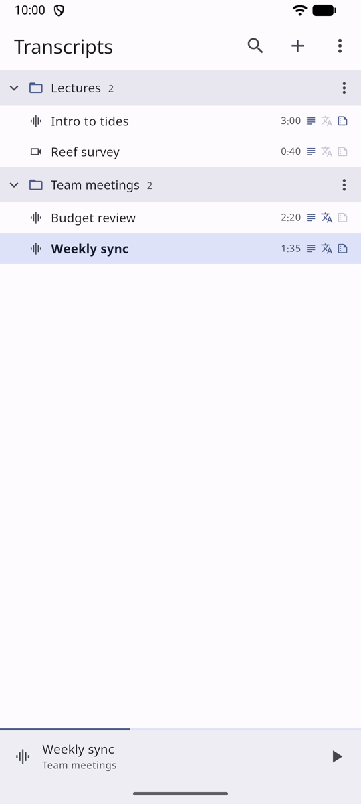
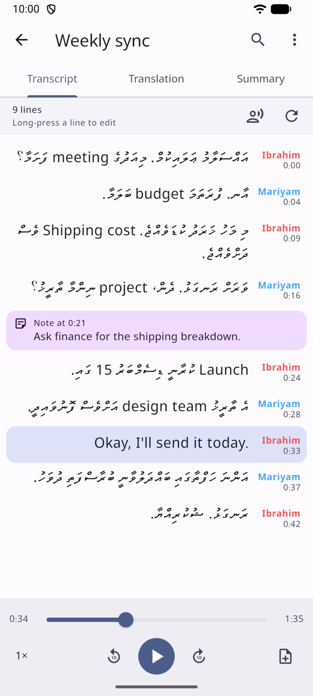
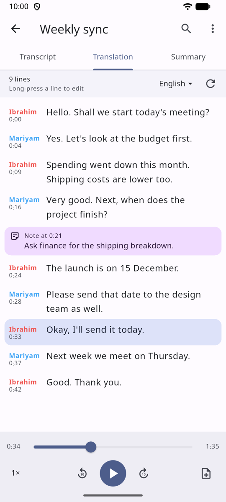
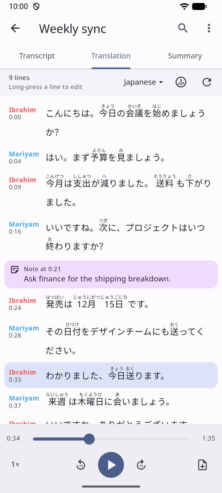
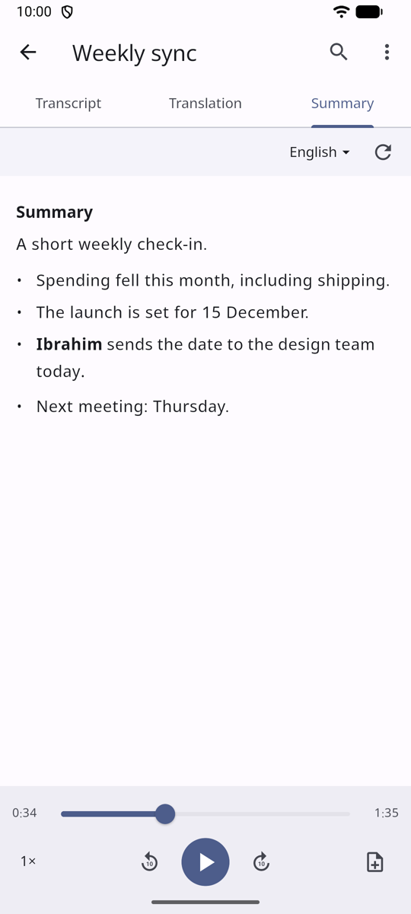

# Transcripts App

An Android app that transcribes recordings with Gemini, then translates and summarizes them with Gemini or Claude. It handles speech that mixes languages, such as Dhivehi, Japanese or Korean with English.

<p>
  
  
  
  
  
</p>

## Features

- Transcripts with speaker labels, synced to playback
- Translations and summaries in any language on your list, and summaries of whole folders
- Furigana above Japanese text
- A context note per recording, sent to the model with its file name
- An editable language list with script, direction, text size and notes for the model
- Audio and video, with fullscreen, subtitles and picture-in-picture
- Notes with photos at points in a recording
- Line editing, speaker renaming, splitting and combining recordings
- Import, sharing, and backup to one zip
- Your own API keys

## Requirements

- Flutter (stable)
- Android Studio, for the Android SDK and emulator
- Android 10 or later

Fetch packages once from the repository root:

```bash
flutter pub get
```

## Signing

Release builds are signed with the key in `android/key.properties`, and without it they cannot be installed. `flutter run` works without one. Android only installs an update signed with the same key, so set this up before the first install:

```bash
keytool -genkey -v -keystore ~/.android/transcripts-release.jks -keyalg RSA -keysize 2048 -validity 10000 -alias transcripts
```

```
storeFile=/Users/<you>/.android/transcripts-release.jks
keyAlias=transcripts
storePassword=...
keyPassword=...
```

## Run

```bash
flutter run
```

To run on a phone over Wi-Fi, turn on Wireless debugging in Developer options, then pair and connect with the addresses it shows:

```bash
adb pair <ip>:<pairing-port>
```

```bash
adb connect <ip>:<port>
```

## Build

```bash
flutter build apk --release --split-per-abi
```

Phones take `build/app/outputs/flutter-apk/app-arm64-v8a-release.apk`. Install it with `adb install -r`, or copy it to the phone and open it.

## Setup

In Settings, under AI models, add a Gemini API key. To translate and summarize with Claude, also add an Anthropic API key and model, then choose Claude.

## Data

Recordings are uploaded to Google's Gemini API for transcription, and the app deletes the upload when the job ends. Each recording's file name and context note go with it. Transcripts, translations and note photos go to Gemini or Claude for translation and summaries. Looking up a language sends its name to Gemini.

The library lives in the app's private storage and is deleted on uninstall. Backup and restore in Settings saves it as one zip, and merges a zip into the library or replaces the library with it.

## Development

```bash
dart format lib test
```

```bash
flutter analyze
```

```bash
flutter test
```

## License

MIT. See [LICENSE](LICENSE). Bundled FFmpeg libraries and Unicode CLDR data are covered by [THIRD_PARTY_NOTICES.md](THIRD_PARTY_NOTICES.md).
